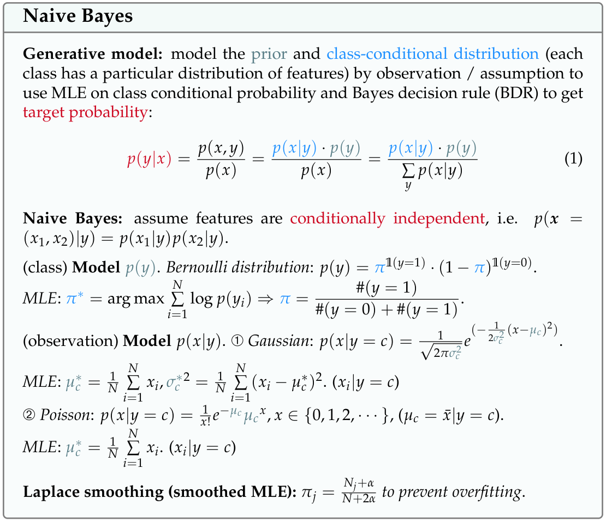
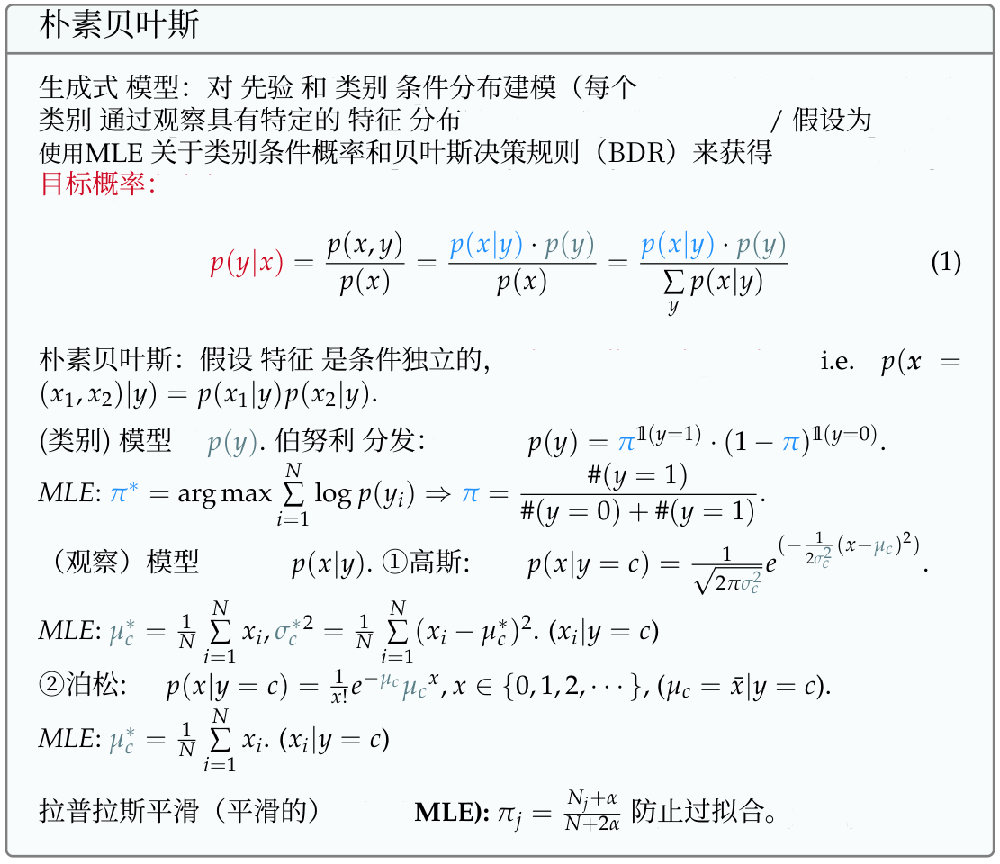

# 论文译读 · PaperBridge｜保留公式排版的论文翻译与对照阅读工具，支持图片文字识别、表格翻译与四种预览，默认免费、可接 DeepSeek/GLM，Windows 安装即用

**保留公式排版，翻完直接对照读。** 将论文翻译、图片文字识别与原文核对整合进同一个 Windows 工具：上传 PDF，翻译完成后直接阅读，需要留存时再下载。

基于 [PDFMathTranslate 1.9.11](https://github.com/PDFMathTranslate/PDFMathTranslate) 的**非官方社区桌面版**，为 Windows 64 位电脑提供中文界面、PDF 对照阅读，以及公式、表格和图片文字的排版修复。

默认使用免费的必应翻译，无需 API Key；也可以选择 DeepSeek、智谱 GLM 等服务，填写自己的 API Key。翻译服务需要联网，自备 Key 服务的费用由相应服务商收取。

**[下载 Windows 安装包](https://github.com/zhang-yutong123/PaperBridge-PDF-Translate-Preserve-Formula-Layout-OCR-Tables-4Way-Compare-Free-DeepSeek-GLM-Windows/releases/latest)** · [查看真实 PDF 示例](examples/CS5489_cheat_sheet-side-by-side.pdf) · [源码构建说明](packaging/BUILD.md)

## 读论文时，少折腾几步

- **公式保留，正文翻译。** 针对原生数学内容保留字形、分数结构及位置，减少密集公式页的排版破坏。
- **翻完就能对照读。** 原文、译文、左右对照、逐页对照在同一界面切换，不必先下载多个文件；阅读区可展开。
- **图片里的英文也能处理。** 集成 OCR，覆盖扫描区域、图片表格、图表标签和幻灯片文字；表格按区域处理，减少译文串行。
- **复杂参数已经内置。** 字体、缓存、并发及页面处理采用程序内置流程，日常使用只需选文件、服务和页码。
- **先免费用，也能接自己的模型。** 默认必应无需 Key，可切换 DeepSeek、GLM 并保存自己的服务配置。
- **Windows 安装即用。** 安装包包含运行环境、字体和识别模型，无需安装 Python 或在命令行配置环境。

上述体验基于 PDFMathTranslate 等开源项目，并加入中文桌面使用流程、四种应用内预览、OCR 与公式/表格处理增强。项目由 [张宇同（zhang-yutong123）](https://github.com/zhang-yutong123) 维护。

## 安装与使用

1. 从 GitHub Releases 下载 `PaperBridge-Setup-2026.10.17.1.exe`，双击安装。
2. 程序创建桌面“PDF论文翻译”快捷方式，并自动打开本机浏览器界面。
3. 上传 PDF 或填写 PDF 下载链接，选择翻译服务和页码，然后点击“开始翻译”。
4. 在原文、译文、左右对照、逐页对照四种阅读模式之间切换，需要留存时下载当前版本。

安装包已包含运行环境、字体和识别模型，使用者无需安装 Python。当前版本为 `2026.10.17.1`。程序按用户安装到 `%LOCALAPPDATA%\Programs\PDF2ZH\2026.10.17.1`，日常设置、缓存与输出保存在 `%LOCALAPPDATA%\PDF2ZH`。

当前安装后的窗口和桌面快捷方式仍显示“论文 PDF 翻译”/“PDF论文翻译”，这是本发行版的程序入口。安装包未进行商业代码签名；Windows 可能显示“发布者未知”，启用 Smart App Control 的电脑也可能阻止启动。

## 功能与适用范围

- 中文设置界面：保存翻译服务与自备 Key，选择语言和指定页码，支持取消任务。
- 四种预览：原文、译文、左右对照、逐页对照（原文与译文交替），支持展开阅读区。
- 原生数学内容修复：保留数学字形、分数线、公式和算法区域的位置，减少密集公式页的排版破坏。
- 图片文字处理：通过本地 OCR 识别表格、图表、幻灯片式页面及扫描区域，再交给所选服务翻译。
- 表格与图形修复：按区域处理文字，尽量保留表格线、图形和原有布局。

不同 PDF 的文字编码、扫描质量和排版差异很大。本项目不承诺任意 PDF 都能完美翻译或保持版式。密集公式中的紧凑注释可能保留原文；复杂表格、低清扫描页和专业术语仍可能出现遗漏或翻译错误，请结合原文对照阅读。

## 真实输出示例：CS5489

以下截图直接渲染自本机生成的 `CS5489_cheat_sheet-左右对照.pdf` 第一页，并裁取同一处朴素贝叶斯公式区域。左图为英文原文，右图为中文译文，可以观察文字翻译与公式字形、分数结构的保留情况；截图没有重新绘制公式。

| 英文原文 | 本地生成的中文译文 |
| --- | --- |
|  |  |

[完整左右对照 PDF](examples/CS5489_cheat_sheet-side-by-side.pdf) 保留原文档标题、日期、署名及其他原有标识。该文件用于展示翻译程序的真实输出，课程资料和教学内容归原作者所有，本项目不主张其原创权。这里展示的是一个具体样例，不代表所有 PDF 的效果。

## 本机界面与数据

Web 界面仅监听当前电脑的 `127.0.0.1:7868`，不启用 Gradio 公网分享。版面分析和 OCR 在本机执行；翻译时，提取出的正文或识别文字会发往你选择的翻译服务。该程序不是离线翻译器。

保存服务配置会在本机写入 API Key。公开仓库和 Releases 不应包含个人设置、Key、缓存、翻译历史或其他个人 PDF；仓库内只提供无 Key 的默认设置和明确授权的 CS5489 示例。

## 源码与构建

```text
app/                    中文界面、桌面运行修复、PDF/OCR 处理模块
app/assets/             无 Key 默认设置、提示词与 OCR 来源说明
upstream/pdf2zh/        随当前发行版提供的 PDFMathTranslate Python 源码
upstream/babeldoc/      随当前发行版提供的 BabelDOC Python 源码
packaging/              PyInstaller、安装器及源码归档脚本
licenses/               随发行版收集的第三方许可证原文
examples/               已授权的 CS5489 左右对照 PDF 与公式截图
requirements.txt        当前发行环境的依赖版本快照
```

构建需要 Windows x64、Python 3.12 和 Releases 中的资源。模型、字体、可执行文件及 PyMuPDF/MuPDF 大型源码归档放在 Releases，避免放入 Git 源码历史。具体资源路径、构建命令和版本更新方法见 [BUILD.md](packaging/BUILD.md)。

## 开源许可与致谢

社区桌面界面与本地修改按 [GNU AGPL-3.0](LICENSE) 提供，保留上游版权和许可。第三方代码、字体、模型及工具遵循各自许可证，详见 [THIRD_PARTY_NOTICES.md](THIRD_PARTY_NOTICES.md) 和 [licenses/](licenses/)。示例 PDF 的教学内容不因随仓库提供而改为 AGPL 授权。

感谢 [PDFMathTranslate](https://github.com/PDFMathTranslate/PDFMathTranslate)、[BabelDOC](https://github.com/funstory-ai/BabelDOC)、[PyMuPDF](https://github.com/pymupdf/PyMuPDF)、[RapidOCR](https://github.com/RapidAI/RapidOCR)、[DocLayout-YOLO](https://github.com/opendatalab/DocLayout-YOLO)、[Source Han Serif](https://github.com/adobe-fonts/source-han-serif)、[Tesseract](https://github.com/tesseract-ocr/tesseract) 及 [cc-pdf2zh-skill](https://github.com/haorantang1999/cc-pdf2zh-skill)。本项目与上述项目没有官方隶属关系。
